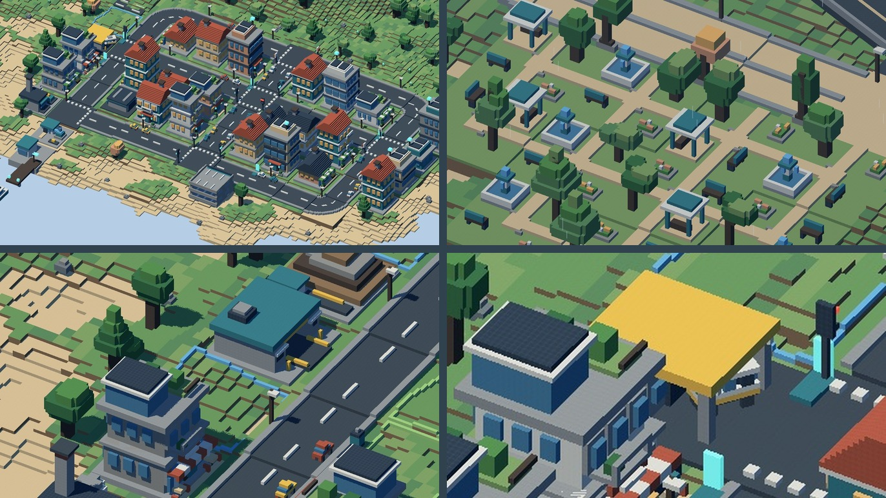

# Ur Building and Decoration Style Guide

Build Ur as a coastal voxel city where a player can recognize a building by its
roof, entrance, and frontage from the normal camera distance. Warm masonry,
weathered teal, blue-grey glazing, and layered greenery tie the city together.
Give each asset a clear job in the street scene. Reserve the smallest details
for closer views.

Clockwise from the upper left, the waterfront shows how roofs and façades work
across a district, the park shows repeated materials across varied layouts, the
bus depot shows an open vehicle bay under a continuous roof, and the sanitation
depot shows a working frontage with high-visibility trim. These are cropped
in-game screenshots.

## Scale and silhouette

A voxel is **0.25 m**. A standard parcel is **32 × 32 voxels**, or **8 × 8 m**.
Procedural buildings repeat floors at an **11-voxel** interval, about **2.75 m**.
Use those buildings and the pedestrians as scale references when designing a
new doorway, bench, shelter, or garage opening.

| View | What should read | Design with |
| --- | --- | --- |
| District | Building type and roof profile | Gables, stepped roof masses, a low canopy, a tower, or a tank |
| Street | Entrances, floor rhythm, and working yards | Recessed doors, window groups, plinths, awnings, loading aprons, and clear gaps |
| Close | Construction and use | Window mullions, bench supports, guard posts, planters, roof vents, and fixtures |

Start with the parcel approach and silhouette. Break up broad visible faces
with a small number of larger shapes before adding trim. Use stepped tiers for
gable ends and tree crowns. A one-voxel lip can read as masonry coping or a
roof edge. Repeat it only where the object has a real edge or seam.

## Materials and color

The IDs below are Ur's existing world materials. The RGB values are base colors
before texture grain and scene lighting. Build from them to keep new assets
consistent with existing streets. The material registry also supplies brick
courses, panel seams, and emission. [Palette and texture definitions](../lib/ur/scene.march)

| Material | Base RGB | Use |
| --- | --- | --- |
| `5` warm sandstone and `8` pale cream | `239, 207, 151` and `228, 228, 207` | Civic and residential walls, pale roof edges, fountain rims |
| `6` terracotta and `18` warm clay | `183, 90, 66` and `218, 158, 117` | Brick, pitched roofs, service accents, peach blossoms |
| `7` painted teal | `53, 128, 133` | Canopies, trim, posts, benches, and selected wall masses |
| `9` blue-grey and `12` pale blue | `75, 130, 157` and `108, 183, 218` | Glazing and basin water, with pale blue for highlights and fountain jets |
| `4` charcoal and `19` slate | `61, 75, 82` and `49, 66, 79` | Paved yards, shadowed entries, dark roofing, metal legs |
| `13` dark brown and `16` buff paving | `76, 66, 57` and `222, 197, 146` | Tree trunks, timber, garden paths, and pedestrian approaches |
| `17` concrete, `23` muted stone, and `24` pale stone | `151, 157, 151`, `149, 151, 140`, and `183, 181, 166` | Plinths, frames, planters, retaining edges, and utility buildings |
| `14`, `21`, `22`, and `25` greens | `57, 116, 69`, `86, 148, 77`, `131, 166, 99`, and `93, 142, 91` | Deep foliage, midtones, pale canopy tips, and park lawns |
| `10` mustard and `15` amber | `250, 196, 79` and `241, 184, 103` | Transit identity, hazard stripes, bollards, blossoms, and warm residential panes |
| `20` cyan and `26`–`31` lights | See the material registry | Signs, lit interiors, fixtures, vehicle lights, and beacons |

For a new model, choose a dominant wall or body material, a supporting
material, and one accent tied to its purpose. Pale trim can define a teal
canopy or turn a deep-blue window band into a row of separate panes. Mustard
works well on a bus depot roof or the posts beside a loading bay. Give light
an identifiable source such as a window, sign, or lamp housing.

## Buildings and frontages

| Building family | References to carry forward |
| --- | --- |
| Zoned homes and shops | A stone plinth, repeated window bays, and a clear ground-floor entrance. Use stepped gables and chimneys on pitched roofs. Give shops a deeper display frontage with a canopy or a restrained storefront accent. |
| Offices and mixed-use blocks | Let glazed bays, a stepped upper storey, or a roof terrace establish the silhouette. Group roof equipment into a few readable forms. |
| Schools, clinics, and civic buildings | Make the public entrance visible from the street. Use a canopy, walk, or forecourt to frame it. Give each facility a feature that signals its purpose, such as a school courtyard or clinic cross. |
| Utilities and working yards | Let the equipment explain the service. A pump house can have pipework and a vessel. A depot can have a broad apron, posts, and recessed bays. Group safety accents around moving equipment and access points. |
| Waterfront facilities | Use concrete platforms, timber piers, modest teal shelters, and clear dock edges. Orient work areas toward the water they serve and leave space for traffic on both sides of the terminal. |

A frontage should work as a route. Find the sidewalk, road, shore, or campus
connection first. Place doors, glazing, bays, and signs where they can be seen
from that approach. On vehicle-served buildings, use the same frontage as the
route. Check the whole vehicle through its turn, including lamps and roof
equipment, then place posts and canopies beyond that swept volume. The bus
depot illustrates this with an open bay, edge columns, and a recessed service
room. [Building layouts](../lib/ur/landscape.march) · [Bus pose and clearance](../lib/ur/scene.march) · [Clearance regression](../test/ur_test.march)

## Decorations, parks, and streets

- **Furniture.** Use stone bases, dark supports, timber seats, and painted
  backs. The existing park bench is six voxels (1.5 m) wide. Place benches
  beside a path or feature with a clear approach and space in front.
- **Planting.** Start with a visible trunk and a canopy made from two or three
  stepped tiers. Give broad shade trees, columnar trees, and leaning trees
  distinct shapes. Keep blossoms clustered on selected crowns or beds.
  Street planters should share their stone, wood, and foliage with parks.
- **Park layouts.** Keep the main axes clear. Existing parks connect through
  four-voxel-wide path arms into a six-voxel-wide central landing. Vary the
  tree form, planting, and furniture orientation by stable parcel seed while
  keeping the path connections fixed. Give a pocket park a bench or small bed.
  Use fountains and shade shelters to mark larger or upgraded gardens.
- **Fountains and shelters.** Build a fountain from a visible rim, inset water,
  and a simple pedestal or jet. Give shelters thin posts, an open interior,
  and a layered roof edge. Their openings and surroundings should look usable
  from the path.
- **Roadside props.** Use the sidewalk placement points already provided by
  the simulation. Check trees and posts against sidewalks, parking bays,
  downhill sightlines, and vehicle turns. Keep ornaments out of lane markings,
  crossing approaches, and reserved curb space.

## Working in the voxel renderer

- Building and prop models use `Ur.Architecture.piece(x, y, z, w, h, d, material)`.
  Author a single-parcel model in local coordinates using positive integer
  extents. Keep `x` and `z` at or above zero and `x + w` and `z + d` at or below
  32. For a multi-parcel structure, use the appropriate parcel pieces, as
  existing campuses do.
- Author road-facing pieces toward **positive Z** before applying
  `Ur.Architecture.orient`. Use the matching road, shore, or campus frontage
  calculation and apply the parcel height once. Check the same pieces after
  a quarter turn and on sloped ground.
- Use the existing model entry points. [Architecture](../lib/ur/architecture.march)
  provides reusable trees, façades, shops, and parking models.
  [Landscape](../lib/ur/landscape.march) assembles the pieces for each parcel.
  [Utilities](../lib/ur/utilities.march) contains working facilities.
- Use one stable seed for each parcel variant. Keep the open space, supports,
  and approach consistent across variants. Put trim on a distinct surface when
  it covers a wall to avoid flickering faces. Keep repeated pieces economical
  because a box can emit six quads.

## Reviewing new assets

1. Open the asset beside existing buildings and decorations. At the default
   zoom, check whether its purpose reads. Zoom in to inspect seams, window
   setbacks, edge trim, and supports.
2. Follow the approach from the street. Walk past decorations, check
   the gaps on connected park tiles, and watch the largest vehicle enter,
   turn, and exit a service bay. For a model that changes operational
   clearance, use a geometry regression like the bus depot check.
3. Inspect daylight, night, and shadow. Check that entrances and dark trim
   still read and that emissive surfaces look like fixtures.
4. Check a repeated block or a multi-parcel park. Confirm the variants look
   related and that paths and frontages remain continuous after rotation.

Run an existing scene from the main checkout with
`UR_DEMO=8 UR_CLOCK_HOUR=12 ./run.sh`, substituting the demo and hour as needed.
Use **F5** to capture a screenshot. Set `UR_FRAMES` and `STRATA_SHOT` for a bounded
capture to a particular file.

| Demo | What to inspect |
| --- | --- |
| `8` | Upgraded parks, furniture, sidewalk planting, and connected paths |
| `9` | Civic buildings, emergency approaches, and night lighting |
| `15` | Bus depot turn, parking structures, and the waterfront district |
| `16` | Sanitation depot, yard equipment, bins, and nearby streets |
